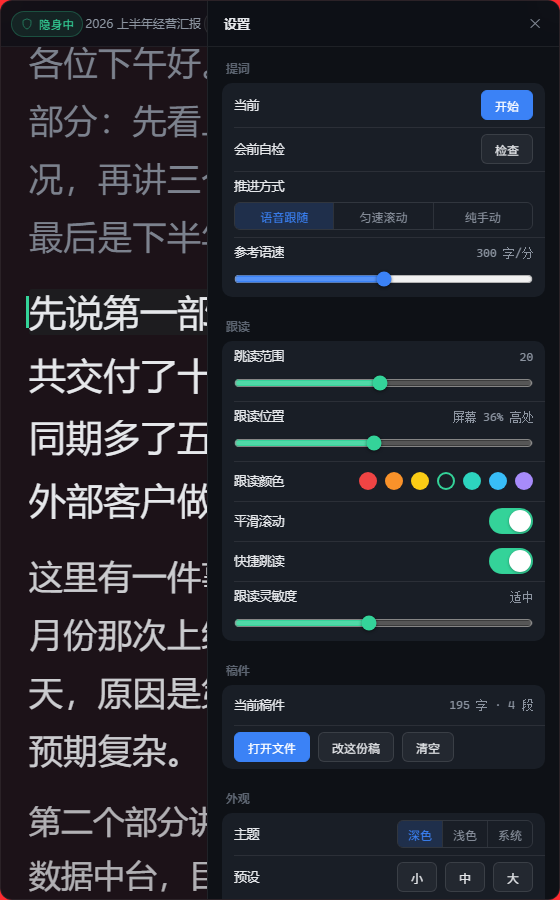
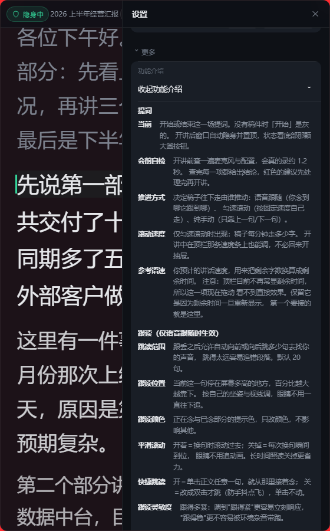
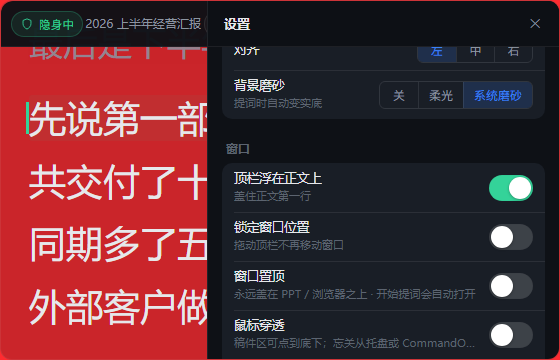

# Prompter · 投屏隐身提词器

**开会投屏讲 PPT 时，提词器窗口不会出现在参会人看到的画面里，同时能跟着你说话自动往下滚。**

不用低头翻稿，也不用担心稿子被投出去。


---

## 它解决哪两件事

| 你烦的 | 它怎么解决 |
|---|---|
| **投屏时稿子会一起被看见** | 提词器窗口从**系统捕获通道里整个移除** —— 不是变透明、不是垫在 PPT 底下，是捕获时它根本不存在。参会人那边**什么都没有**。<br>（实测口径：开启隐身时的截屏与「窗口完全隐藏」逐像素差异 **0.00%**；关掉隐身时同一区域 **92.9%** 的像素变了） |
| **讲的时候腾不出手翻稿** | 它**听你说话**：念到哪、光标跟到哪。说一句无关的话不会把稿子带跑；讲错了它会停住等你，不会把你甩在后面 |

```
        ┌─ 你的屏幕 ────────────────────┐        ┌─ 参会人看到的 ──────┐
        │  ┌────────────┐               │        │  ┌────────────┐     │
        │  │  PPT       │               │        │  │  PPT       │     │
        │  └────────────┘               │        │  └────────────┘     │
        │  ┌────────────┐ ← 提词器      │        │                     │
        │  │ 汇报稿...  │   隐形        │        │   （什么都没有）     │
        │  └────────────┘               │        │                     │
        └───────────────────────────────┘        └─────────────────────┘
```

**不想用语音也完全能用** —— 切到「手动模式」，热键翻页。核心价值（投屏看不见）不依赖语音，**也不用下载识别模型**。

---

## 界面：只有一条栏

所有控件压在**窗口最上方 46px 的一行**里，正文从它下方开始 —— 560px 宽的窗口里，把面积尽量留给稿子。


界面上只守一条规则：**状态自己说话**。左边那盏灯就是「现在隐身了吗」；右边那个槽在同一行里接力显示麦克风异常 / 滚动速度 / 穿透未生效。

> **整个界面没有任何悬停提示**（没有 `title`、没有自绘气泡）。需要解释的东西统一收进
> 「设置 › 更多 › 功能介绍」，默认收起 —— 设置里每一行的垂直空间都留给控件本身。

<table>
<tr>
<td></td>
<td></td>
</tr>
<tr>
<td align="center"><sub>设置：分组卡片，控件收成单行</sub></td>
<td align="center"><sub>功能介绍：说明全在这里，默认收起</sub></td>
</tr>
</table>

外观可以在深色 / 浅色 / 跟随系统之间切，背景支持三档磨砂（关 / 柔光 / 系统磨砂）：



---

## 装上，打开

### Windows

**[下载 Prompter_0.1.0_x64-setup.exe](https://github.com/renoo777/prompter/releases/latest/download/Prompter_0.1.0_x64-setup.exe)**（6.25 MB）→ 双击 → 下一步。装完开始菜单里就有「Prompter」。

* 装在**当前用户目录**下，不弹管理员授权。
* Windows 10 / 11 自带 WebView2，一般不用再装别的；万一没有，安装包会联网补一份。
* 只想要一个免安装的裸 exe、或者想自己出包 —— 见下面的「[出包 / 给别人用](#出包--给别人用)」。

### macOS

```bash
./build.sh              # 打 .app（首次会先做编译检查 + 跑单测）
./build.sh --dmg        # 顺便打 dmg
open src-tauri/target/release/bundle/macos/Prompter.app
```

开发模式（改前端代码即时热更新，不用反复重新打包）：`./run-dev.sh`

> ⚠️ **首次打开会被 Gatekeeper 拦下** —— 这是必然的：macOS 上的隐身用了未文档化的私有 API
> （Apple 自 macOS 15 起已不提供公开 API），无法签名与公证。表现可能是「来自身份不明的开发者」，
> 也可能是「App 已损坏」。macOS 15 起**「右键 → 打开」的旁路已取消**，两条路走同一个出口：
> 「系统设置 → 隐私与安全性 → 仍要打开」。等不及的也可以直接去掉隔离标记：
>
> ```bash
> xattr -d com.apple.quarantine "src-tauri/target/release/bundle/macos/Prompter.app"
> ```
>
> ⚠️ **别用 Finder 双击 `.app` 来跑开发模式** —— `./run-dev.sh` 连的是本地 vite 服务，
> 双击跑的是打包产物。**要独立运行必须先 `./build.sh` 出包。**

---

## 用起来

### 快捷键（全局生效，焦点在 PPT 上也管用）

| 快捷键 | 作用 |
|---|---|
| `Ctrl + Alt + Space` | 开始 / 停止语音识别 |
| `Ctrl + Alt + ↓` | 下一句 |
| `Ctrl + Alt + ↑` | 上一句 |
| `Ctrl + Alt + S` | 切换投屏隐身 |
| `Ctrl + Alt + H` | 显示 / 隐藏窗口 |
| `Ctrl + Alt + P` | 切换鼠标穿透（开穿透后靠它 / 托盘才能收回来） |
| `Ctrl + Alt + M` | 收起 / 展开（收起＝只留窗口最上方那一条栏） |
| `Ctrl + ,` | 打开 / 关闭设置 |
| `Ctrl + K` | 打开稿件历史库 |
| `Ctrl + F` | 稿内查找（**不是**浏览器搜索） |
| `Ctrl + E` | 粘贴 / 编辑稿件（已有稿子时默认进编辑） |
| 点击任意句子 | 光标跳到该句 |
| 拖动顶栏那条进度条 | 任意跳转（点轨道即跳） |

热键可以在配置文件里改（改完需重启生效）。配置文件位置显示在「设置 → 诊断」。

### 开会前的 30 秒检查

1. 顶栏左边那盏状态灯是**绿色**、写着「隐身中」
2. 按 `Win + Shift + S` 截个全屏，打开截图确认**提词器窗口不在里面**
3. 开飞书共享，让同事看一眼确认
4. 想用语音跟随的话：**设置 → 语音识别 → 麦克风自检**，对着麦克风说一句，看到「拾音正常」再往下走

第 2 步和第 3 步**都要做** —— 系统截图看不见 ≠ 会议客户端看不见，两者走的是不同的捕获通道。
第 4 步也别省，麦克风不收音是这套东西最难自己发现的故障。

> 想让语音跟随跑起来，先下一次本地识别模型（约 190 MB，走国内镜像、支持断点续传）：
> ```
> python scripts\fetch-model.py
> ```
> 下完在程序里「设置 → 语音识别 → 开始识别」。

---

## 现状：哪些能用，哪些还没验

| 能力 | Windows | macOS |
|---|---|---|
| **投屏隐身** | ✅ 已实测（真实飞书会议 + 自动化抓屏对比） | ✅ 已真机跑通 · ⚠️ **「在哪个会议软件里隐身」的逐项矩阵仍未测完**（见下） |
| 语音跟随 / 麦克风自检 / 静音看门狗 | ✅ 本地离线识别，中文与中英混说实测可用 | ✅ 已真机跑通 |
| 稿件管理：txt · md · **docx · pptx** · 拖入 · 粘贴 · 编辑 · 稿内查找 · 历史库 | ✅ | ✅ |
| 排版工具箱：字号 · 行高 · 字距 · 段距 · 对齐 · 锚点 | ✅ | ✅ |
| 匀速滚动 · 跟读灵敏度 · 语速估算 | ✅ | ✅ |
| 一键开始提词（中央大按钮）· 会前自检 | ✅ | ✅ |
| 鼠标穿透（含三条退出口）· 托盘 · 收起展开 · 全屏 | ✅ | ✅ 已真机跑通（「收进任务栏」那一项在 Mac 上不出现 —— 那里没有任务栏） |
| 外观：深 / 浅主题 · 磨砂背景 · 分组式设置面板 | ✅ | ✅ |
| 窗口尺寸记忆 · 副屏拔掉自动拉回主屏 | ✅ | ✅ |
| 第二设备同步 | 未实现 | — |

> **macOS 这一列现在是「已上真机」**（2026-10-10，作者在自己的 Mac 上自建 `.app` 跑通）。

> ⚠️ **但「跑得起来」不等于「每个会议软件里都隐身」**：macOS 15（Sequoia）起 Apple 改了 WindowServer 架构，
> ScreenCaptureKit 直接读取合成后的最终画面，**公开 API 已无法阻止屏幕捕获**。代码里预留了私有 API 路径，
> 但它未经 Apple 认可，**且不同会议软件结论可能相反**（走 ScreenCaptureKit 的可能看得见、走 CoreGraphics 的可能看不见）。
> 这一项**必须逐个软件实测**才能下结论，目前还没测完 —— 想确认自己那个软件行不行，请自己验一遍
> （**别拿没验过的场景当已验过**，这是本项目唯一不肯含糊的地方）。验证方法在下面「还想往下看」那一节里。

---

## 还想往下看

产品页只负责回答三件事：**这是什么、怎么用、信不信得过**。想再深一层，只有这三份是给**使用者**的：

| 文档 | 你在什么疑问下会点开它 |
|---|---|
| [技术决策与架构](docs/技术决策与架构.md) | 「它凭什么能做到？」—— 架构图 + 十几个关键决策的取舍过程 |
| [能力清单与验证状态](docs/能力与验证状态.md) | 「你说的我信吗？」—— 逐条能力的**证据与数字**，包括没做成的那些 |
| [隐身验证与排查](docs/隐身验证与排查.md) | 「我自己验一遍」—— 「隐身到底生效没有」的自动化验证方法 |

其余文档是**我们自己干活用的**，跟「用这个产品」无关，所以不在这里列。

---

## 改代码（开发者）

```bat
run-dev.bat            :: 开发模式：自动装依赖 + 编译 Rust，之后前端热更新
build.bat              :: 出 release 产物 → src-tauri\target\release\prompter.exe
```

> ★★ **改完代码得重新构建 + 重启，屏幕上才会变** —— 跑的是 release exe，已经在跑的进程不会自己换。
> 构建走 `npm run tauri:build`（带 `--no-bundle`，但**必须走它**：裸 `cargo build --release` 不带
> `custom-protocol`，前端资源嵌不进去，起来是白屏）。
>
> ★ **别拿 `target\debug\prompter.exe` 当交付物** —— 那是 `tauri dev` 的产物，它要连本地 vite，
> 双击只会看到「无法访问此页面」。**能独立运行的只有 release 产物。**

### 出包 / 给别人用

**Windows 的现成安装包在 [Releases](https://github.com/renoo777/prompter/releases) 里**（`Prompter_0.1.0_x64-setup.exe`，6.25 MB）。
要自己出一个、或者给别的平台出，按下面走：

| 场景 | 做法 | 结果 |
|---|---|---|
| **Windows → Windows** | `npx tauri build --bundles nsis` | 一个 **6.25 MB** 安装包，双击即装 |
| **Windows → macOS** | `.exe` 完全用不了；要在 **Mac 上**用源码构建出 `.app` | 见上面 macOS 一节。★ 未签名、未公证 —— **对方首次打开必须自己过一遍 Gatekeeper** |

* **别直接拷 `prompter.exe`** —— 它依赖系统的 WebView2 运行时，对方没装就是「双击没反应、且没有任何提示」。
* ★ **出包不要写 `npm run tauri:build -- --bundles nsis`**：脚本里的 `--no-bundle` 会把它**静默压掉**（命令成功、只出裸 exe）。直接调 CLI。
* 完整步骤（含传输方式、Mac 前置条件）在 `docs/分发到另一台电脑.md`；索引见下方。

改代码前的硬约束（哪些设计不能再动、门槛怎么跑）在 [`docs/判断基线.md`](docs/判断基线.md)。
**其余维护者向文档**（判据、需求拆解、竞品调研、分发、上机测试、仓库操作…）的索引见
[`docs/README.md`](docs/README.md)。
