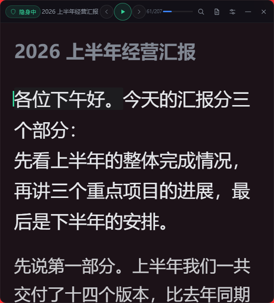
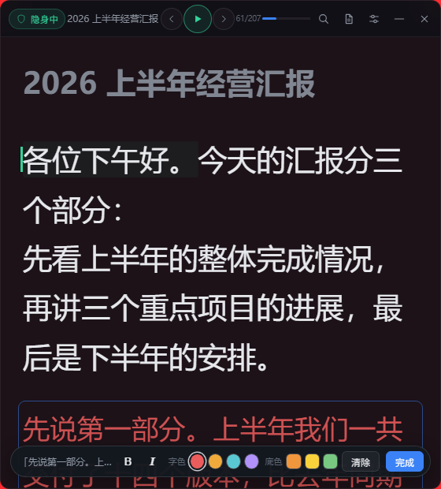

## Prompter v0.1.2

投屏隐身提词器：共享屏幕 / 投屏时，稿件窗口**不进入画面**，跟着你说话自动滚动。

### 这个版本能做什么（相对 v0.1.1）

这一版只干了两件事，都是"稿子在你面前的样子"。

**一、粘进来什么样，显示就什么样。**

以前不管你怎么排版，粘进 Prompter 都会被压成一坨：所有段落被空格拼成一片，
标题里的 `#` 直接露在正文里，Word 里分好的段也会挤成一段。现在不会了。

- 段与段之间空一行，显示就空一行；空两行的还是空两行
- 段内你自己敲的换行保留，不再被抹平
- `# 标题` 会按标题的样子显示（字号比正文大一号），`#` 本身不会出现在画面上
- `---` 这种分隔线直接丢掉，不留痕迹
- 从 Word（.docx）导入，一个自然段就是一个段落，不再是整篇一段

打开"编辑"弹窗看到的也是排好版的原文，保存回去结构不会被吃掉。



**二、标重点。** 一整段可以加粗、变斜体、换字色、加底色。

进法：打开稿件历史（或稿件面板）→ 点 **[标重点]** → 面板收起，进入标重点模式。

- 点任意一段，底部弹出一条工具栏；点色块，这一整段立刻变
- 四个字色、三个底色，点 **[清除]** 回到原样，点 **[完成]** 退出
- 加粗和斜体可以跟颜色同时用
- 标好的段落在"正在念"的时候，正在念的那个字仍然是绿灯 —— 颜色不会盖住跟读提示
- 深色、浅色、磨砂三种主题下都配了各自能看清的颜色（浅色主题下是更深的红/蓝/绿）



**标好的样式跟着稿子走。** 存在稿件库里，关掉软件、重开、从历史里重新载入，颜色还在。
但如果你后来把那一**段**的字改了，那一段的样式会自己消失（其余段不受影响）——
因为位置变了还硬挂着颜色，很可能把"这段别念"的红标挂到别的段上。宁可少显示，不要标错。

### 已经在用 v0.1.1 的，这一版会自己更新

从 v0.1.1 起软件里带了自动更新。启动约 3 秒后会自己查一次，
顶栏下面出现 `新版本 0.1.2 可用（当前 0.1.1）` → 点 **[更新]** → 下载 → 安装 → 自动重开。
不想现在装就点 **[稍后]**，下次启动会再问。

**v0.1.0 及更早的版本不行** —— 那些版本里没有更新功能，得手工装这一次。

### 安装（Windows）

下载 **`Prompter_0.1.2_x64-setup.exe`**（6.92 MB）→ 双击 → 下一步。
装完开始菜单里就有「Prompter」。

- 按**当前用户**安装，**不需要管理员权限**
- 依赖系统的 WebView2 运行时；万一机器上没有，安装包会联网补一份
- 装的时候软件如果正开着，安装器会先关掉它、装完再自己启动
- 想卸载：Windows 设置 → 应用 → Prompter

### macOS

已上真机、可正常使用。更新链路在 macOS 上也接了（装完会自动重启到新版）。
**但「在每个会议软件里是否隐身」仍在逐软件补测** —— 没验过的先别当已验过的。

### 校验

```
sha256  215196b84ab30422d445197445ce2410b15e00b22474d6383f846f3135fd399e
文件    Prompter_0.1.2_x64-setup.exe（7,258,840 字节）
```

### 更新包是**签名**的，装不上就是没验过

软件下载到的更新包，在安装前必须通过 **minisign 签名校验**。
签名对不上（包里被塞了东西、或者签名与内置公钥不匹配）就**拒绝安装**，
而不是"装上了但没验"。⇒ 即使传输环节被人做了手脚，也装不进去。

### 已知欠账（都写在这里，不藏着）

- **标重点只能整段**：选中半句话标是不行的。要做到"只标几个字"，编辑器得换成富文本，
  那是另一摊活，这一版没动
- **Word 里的加粗/颜色不会导入**：docx 里的样式目前只读文字，不读格式
- **macOS 隐身逐软件结果**：未出全
- **第二台设备同步**：未实现，目前只能手动导入导出
- ~~自动更新 / 版本检查~~：v0.1.1 已还
- ~~段落挤成一团、标题露出 `#`~~：**这一版已还**
